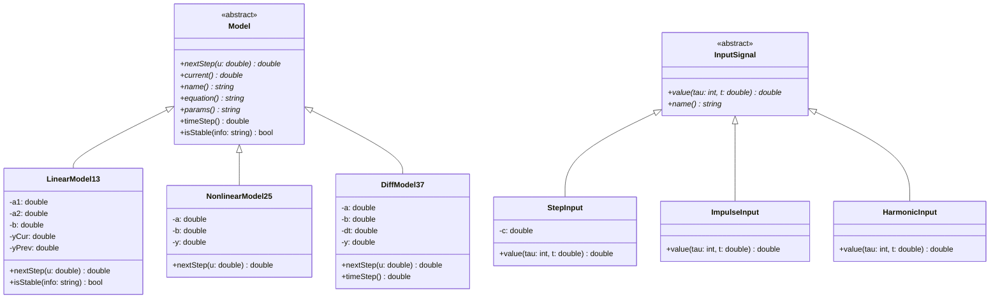
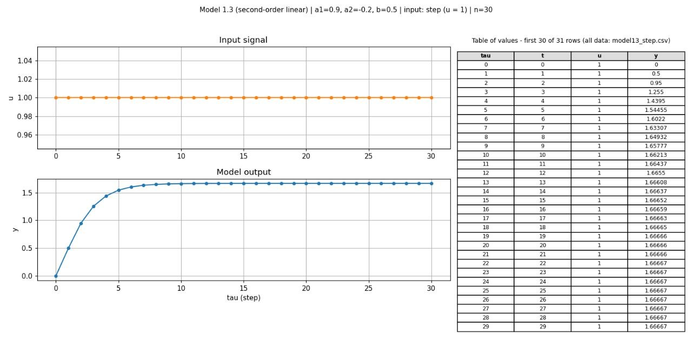
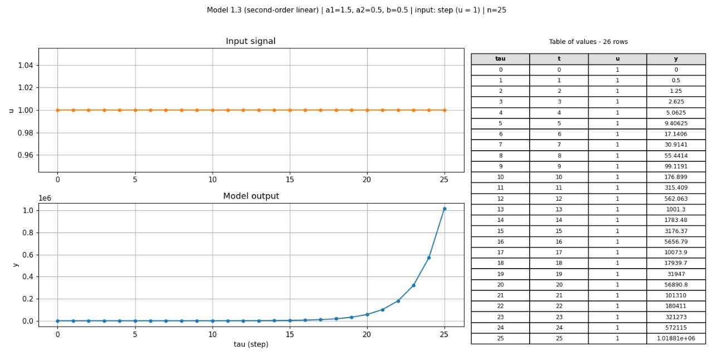
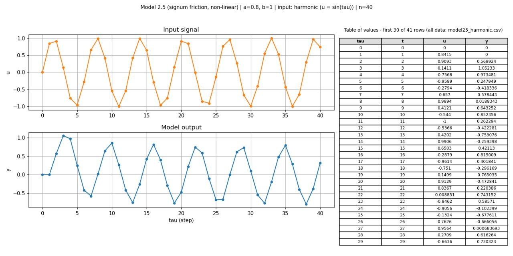
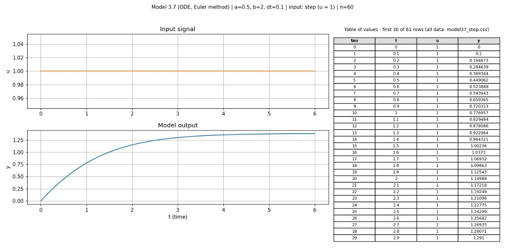

<p align="center">Министерство образования Республики Беларусь</p>
<p align="center">Учреждение образования</p>
<p align="center">«Брестский государственный технический университет»</p>
<p align="center">Кафедра интеллектуальных информационных технологий</p>
<br><br>
<p align="center"><b>Лабораторная работа № 1</b></p>
<p align="center">по дисциплине «Общая теория интеллектуальных систем»</p>
<p align="center">«Моделирование объектов управления»</p>
<br><br>
<p align="right">Выполнила:</p>
<p align="right">Студентка группы ИИ-29</p>
<p align="right">Белозерова А. А.</p>
<p align="right">Проверил: Дворанинович Д. А.</p>
<br><br>
<p align="center">Брест 2026</p>


**Вариант:** 3.

## 1. Цель работы

Создать программу для моделирования трёх объектов варианта 3. Предусмотреть выбор модели и входного сигнала, ввод параметров, количество шагов, табличный вывод, построение графика и проверку устойчивости линейной модели. Использовать объектно-ориентированный подход.

## 2. Модели варианта 3

### 2.1. Линейная модель 1.3

`y(t+1) = a1*y(t) + a2*y(t-1) + b*u(t)`.

Модель второго порядка: следующее значение зависит от двух предыдущих значений выхода и от входа. Все связи выражены умножением на постоянные коэффициенты, поэтому модель линейная. Пользователь вводит `a1`, `a2`, `b` и начальное значение `y(0)`.

### 2.2. Нелинейная модель 2.5

`y(t+1) = a*y(t) + b*sign(u(t))*(1 - exp(-|u(t)|))`.

Нелинейность возникает из-за множителя `1 - exp(-|u|)`: он не превышает 1, поэтому добавка к выходу ограничена значением `b` (насыщение). Пользователь вводит `a`, `b` и `y(0)`.

### 2.3. Дифференциальная модель 3.7

`dy/dt = -exp(a*y) + b*u`.

Для численного расчёта используется метод Эйлера:

`y(t+1) = y(t) + dt*(-exp(a*y(t)) + b*u(t))`.

Пользователь вводит `a`, `b`, положительный шаг `dt` и `y(0)`.

## 3. Входные воздействия

| Номер | Воздействие | Формула |
|---:|---|---|
| 1 | Ступенчатое | `u(t) = A` |
| 2 | Импульсное | `u(0) = 1`, далее `u(t) = 0` |
| 3 | Гармоническое | `u(t) = sin(t)` |

Для дифференциальной модели время `t = tau*dt`, где `tau` — номер шага. Число шагов `n` вводится пользователем. За один расчёт программа обрабатывает одну модель с одним входным воздействием.

## 4. Алгоритм программы

1. Пользователь выбирает одну из трёх моделей.
2. Вводит коэффициенты выбранной модели (Enter подставляет значение по умолчанию).
3. Выбирает входное воздействие.
4. Вводит число шагов моделирования `n`.
5. Для модели 1.3 программа находит корни характеристического уравнения и выводит предупреждение, если система неустойчива.
6. На каждом шаге программа вычисляет `u(t)` и следующее значение `y(t)`.
7. Результаты выводятся таблицей в консоль и сохраняются в CSV-файл.
8. Автоматически открывается график (Python/matplotlib).

## 5. Объектно-ориентированное программирование

Абстрактный класс `Model` задаёт общий интерфейс:

- `nextStep(u)` вычисляет следующий шаг;
- `current()` возвращает текущее значение выхода;
- `name()`, `equation()`, `params()` описывают модель;
- `isStable()` проверяет устойчивость.

Классы `LinearModel13`, `NonlinearModel25` и `DiffModel37` наследуются от `Model` и реализуют метод `nextStep` по своим формулам. Основной цикл вызывает этот метод через указатель на `Model`, поэтому отдельный цикл для каждой модели не нужен. Входные сигналы устроены так же: абстрактный `InputSignal` и наследники `StepInput`, `ImpulseInput`, `HarmonicInput`.

### UML-диаграмма классов

Та же диаграмма вынесена в отдельный файл: [UML.md](UML.md).



### Структура каталога

```
trunk/ii02903/task_01/
├── src/
│   ├── build.bat         # сборка через CMake
│   ├── run.bat           # запуск программы
│   ├── CMakeLists.txt
│   ├── main.cpp          # меню, ввод, расчёт, таблица, CSV
│   ├── models.h          # класс Model и наследники
│   ├── signals.h         # входные сигналы
│   └── plot.py           # график и таблица (Python / matplotlib)
└── doc/
    ├── readme.md         # этот отчёт
    ├── UML.md            # UML-диаграмма классов
    └── img/              # скриншоты
```

## 6. Сборка и запуск

На Windows нужно запустить `src\build.bat`: скрипт настраивает CMake и собирает программу. Затем `src\run.bat` запускает её. Нужны CMake, компилятор C++, Python и `pip install matplotlib`.

Ручная сборка:

```text
cmake -S src -B build
cmake --build build --config Release
```

Пример ввода для линейной модели:

```text
модель: 1
a1 = 0.5
a2 = 0.3
b = 1
y(0) = 0
сигнал: 1 (ступенчатое), u = 1
число шагов: 20
```

## 7. Анализ устойчивости (Advanced Level)

Для Model 1.3 характеристическое уравнение имеет вид:

`z^2 - a1*z - a2 = 0`, откуда `z = (a1 ± sqrt(a1^2 + 4*a2)) / 2`.

Система асимптотически устойчива, если оба корня лежат внутри единичной окружности, то есть модуль каждого корня меньше 1. Эквивалентно (условия Джури):

- `|a2| < 1`;
- `1 - a1 - a2 > 0`;
- `1 + a1 - a2 > 0`.

Если корни комплексные (`a1^2 + 4*a2 < 0`), то модуль корня равен `sqrt(-a2)`.

В программе корни вычисляются по этим формулам. Если модуль хотя бы одного корня не меньше 1, перед началом симуляции в консоль выводится предупреждение.

## 8. Результаты

### 8.1. Model 1.3, ступенчатый вход (устойчивая система)

Параметры: `a1 = 0.9`, `a2 = -0.2`, `b = 0.5`, `u = 1`. Корни: `z1 = 0.5`, `z2 = 0.4`, оба меньше 1. Установившееся значение: `y = b*u / (1 - a1 - a2) = 0.5 / 0.3 ≈ 1.667`.

```
Stability analysis: characteristic roots: z1 = 0.5, z2 = 0.4, max|z| = 0.5
The system is stable (all |z| < 1).

   tau           t             u               y
------------------------------------------------
     0           0             1               0
     1           1             1             0.5
     2           2             1            0.95
     3           3             1           1.255
     4           4             1          1.4395
     5           5             1         1.54455
     6           6             1          1.6022
```



### 8.2. Model 1.3 (неустойчивая система)

Параметры: `a1 = 1.5`, `a2 = 0.5`. Корни: `z1 ≈ 1.78`, `z2 ≈ -0.28`. Условие устойчивости нарушено, программа выдаёт предупреждение:

```
Stability analysis: characteristic roots: z1 = 1.78078, z2 = -0.280776, max|z| = 1.78078
!!! WARNING: the system is NOT stable (|z| >= 1) - the process will diverge or oscillate without decay !!!
```



### 8.3. Model 2.5, гармонический вход

Параметры: `a = 0.8`, `b = 1`. Выход ограничен, так как нелинейный член `b*sign(u)*(1 - exp(-|u|))` по модулю меньше `b`, а при `|a| < 1` система «забывает» прошлое.



### 8.4. Model 3.7, ступенчатый вход

Параметры: `a = 0.5`, `b = 2`, `dt = 0.1`, `u = 1`. Равновесие достигается, когда скорость равна нулю: `-exp(a*y) + b*u = 0`, откуда `y = ln(b*u) / a = ln 2 / 0.5 ≈ 1.386`. Решение выходит на это значение.



## 9. Вывод 

В программе реализованы три модели варианта 3 на основе ООП: абстрактный класс `Model` и три наследника. Модели протестированы на ступенчатом, импульсном и гармоническом воздействиях. Для линейной модели получено условие устойчивости через корни характеристического уравнения и реализована проверка с предупреждением. Результаты выводятся таблицей, сохраняются в CSV и отображаются на графике.
