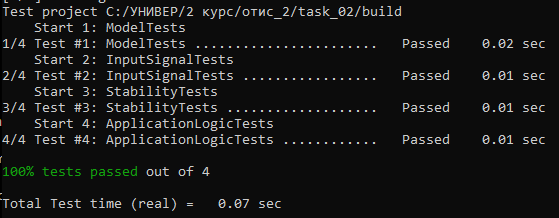

 <p align="center">Министерство образования Республики Беларусь</p>
<p align="center">Учреждение образования</p>
<p align="center">«Брестский государственный технический университет»</p>
<p align="center">Кафедра ИИТ</p>

<br><br><br><br><br><br>

<p align="center">Лабораторная работа №2</p>
<p align="center">По дисциплине «Общая теория интеллектуальных систем»</p>
<p align="center">Тема: «Модульное тестирование программы моделирования управляемого объекта»</p>
<p align="center">Вариант 5</p>

<br><br><br><br><br>

<p align="right">Выполнил:</p>
<p align="right">Студент 2 курса</p>
<p align="right">Группы ИИ-29</p>
<p align="right">Горун Т.В.</p>
<p align="right">Проверил:</p>
<p align="right">Дворанинович Д.А.</p>

<br><br><br><br><br>

<p align="center">Брест 2026</p>

---

## 1. Цель работы

Освоить принципы модульного тестирования программ на языке C++. Разработать автоматизированные тесты для проверки математических моделей, генерации входных сигналов, анализа устойчивости и логики работы приложения.

Настроить сборку проекта и запуск тестов с помощью CMake и командных файлов `.bat`.

## 2. Постановка задачи

1. Использовать программную реализацию математических моделей из лабораторной работы №1.
2. Разработать модульные тесты для проверки работы моделей.
3. Проверить правильность генерации входных сигналов.
4. Реализовать и протестировать анализ устойчивости модели.
5. Проверить обработку пользовательского ввода и работу основной логики приложения.
6. Настроить автоматическую сборку и запуск тестов.
7. Проверить корректность работы программы с помощью тестирования.

## 3. UML-диаграмма классов

В проекте используется объектно-ориентированная архитектура.

Абстрактный базовый класс `Model` определяет общий интерфейс для математических моделей. От него наследуются классы `Model15`, `Model27` и `Model39`.

Основные компоненты программы:

- `Model` — абстрактный базовый класс.
- `Model15` — реализация модели 1.5.
- `Model27` — реализация модели 2.7.
- `Model39` — реализация модели 3.9.
- `InputSignal` — генерация входных сигналов.
- `Simulation` — выполнение процесса моделирования.
- `StabilityAnalyzer` — анализ устойчивости модели.
- `ApplicationLogic` — взаимодействие с пользователем и управление работой программы.

## 4. Описание математических моделей

В программе реализованы три математические модели согласно варианту 5.

### 4.1. Модель 1.5

Модель описывается разностным уравнением:

<p align="center">
  <strong>y<sub>t+1</sub> = a<sub>1</sub> · y<sub>t</sub> + a<sub>2</sub> · y<sub>t-k</sub> + b · u<sub>t</sub></strong>
</p>

Используемые параметры:

- a<sub>1</sub> = 0.6;
- a<sub>2</sub> = 0.2;
- b = 0.5;
- k = 2.

Для хранения предыдущих значений выходного сигнала используется динамическая последовательность значений.

### 4.2. Модель 2.7

Модель использует релейный элемент с гистерезисом.

<p align="center">
  <strong>y<sub>t+1</sub> = a · y<sub>t</sub> + b · relay(u<sub>t</sub>)</strong>
</p>

Параметры модели:

- a = 0.8;
- b = 0.7;
- ε = 0.2.

Состояние реле изменяется в зависимости от входного сигнала и порогового значения гистерезиса.

### 4.3. Модель 3.9

Модель описывается дифференциальным уравнением:

<p align="center">
  <strong>dy/dt = b · tanh(u)</strong>
</p>

Для численного решения используется метод Эйлера:

<p align="center">
  <strong>y<sub>t+1</sub> = y<sub>t</sub> + dt · b · tanh(u<sub>t</sub>)</strong>
</p>

Параметры:

- b = 1.0;
- dt = 0.1.

## 5. Входные сигналы

В программе реализована генерация трёх типов входных сигналов.

| Тип сигнала | Описание |
|---|---|
| Step | Постоянный сигнал со значением 1 |
| Impulse | Импульс со значением 1 на первом шаге и 0 на остальных |
| Harmonic | Гармонический сигнал, вычисляемый по формуле u(τ) = sin(τ) |

Генерация сигналов выполняется классом `InputSignal`.

## 6. Структура проекта

Проект имеет следующую структуру:

```text
task_02/
│
├── doc/
│   ├── image.png
│   └── screenshots/
│       ├── uml_diagram.PNG
│       └── test_results.png
│
├── src/
│   ├── ApplicationLogic.h
│   ├── ApplicationLogic.cpp
│   ├── Simulation.h
│   ├── Simulation.cpp
│   ├── StabilityAnalyzer.h
│   ├── StabilityAnalyzer.cpp
│   ├── Model.h
│   ├── Model15.h
│   ├── Model15.cpp
│   ├── Model27.h
│   ├── Model27.cpp
│   ├── Model39.h
│   ├── Model39.cpp
│   ├── InputSignal.h
│   ├── InputSignal.cpp
│   ├── main.cpp
│   └── CMakeLists.txt
│
├── test/
│   ├── test_application_logic.cpp
│   ├── test_main_input.cpp
│   ├── test_models.cpp
│   ├── test_stability.cpp
│   └── CMakeLists.txt
│
├── CMakeLists.txt
├── build.bat
├── run_tests.bat
├── run_tests.sh
└── readme.md
```

## 7. Описание модульных тестов

Для проверки правильности работы программы созданы отдельные тестовые файлы.

| Файл | Что проверяет |
|---|---|
| `test_models.cpp` | Работу математических моделей и правильность вычисления выходных значений |
| `test_main_input.cpp` | Генерацию входных сигналов |
| `test_stability.cpp` | Работу алгоритма анализа устойчивости |
| `test_application_logic.cpp` | Обработку пользовательского ввода, проверку допустимых значений и работу логики приложения |

Тестирование разделено на отдельные исполняемые программы. Это позволяет проверять разные компоненты проекта независимо друг от друга.

### 7.1. Тестирование математических моделей

В тестах проверяется корректность вычислений моделей 1.5, 2.7 и 3.9.

Для сравнения результатов используется проверка с допустимой погрешностью, поскольку при вычислениях с типом `double` возможны небольшие ошибки округления.

### 7.2. Тестирование входных сигналов

Проверяется правильность формирования трёх типов сигналов:

- постоянного;
- импульсного;
- гармонического.

### 7.3. Тестирование анализа устойчивости

Проверяется функция `StabilityAnalyzer::isStable()`.

Для модели 1.5 используется характеристическое уравнение:

<p align="center">
  <strong>z<sup>k+1</sup> - a<sub>1</sub> · z<sup>k</sup> - a<sub>2</sub> = 0</strong>
</p>

Устойчивость определяется по расположению корней характеристического уравнения относительно единичной окружности.

### 7.4. Тестирование логики приложения

Проверяется правильность обработки пользовательского ввода.

Рассматриваются следующие ситуации:

- корректный выбор модели;
- некорректный номер модели;
- некорректный тип входного сигнала;
- недопустимое количество шагов моделирования.

## 8. Локальная автоматизация сборки и тестирования

Для автоматизации сборки и запуска тестов используется CMake и командный файл `run_tests.bat`.

Скрипт выполняет следующие действия:

1. Переходит в корневую директорию проекта.
2. Выполняет конфигурацию проекта с помощью CMake.
3. Собирает основную программу и тестовые программы.
4. Запускает тестирование с помощью CTest.
5. Выводит результаты выполнения тестов.

**Запуск тестирования:**

```bat
run_tests.bat
```

Также тесты можно запустить вручную с помощью следующих команд:

```bash
cmake -S . -B build
cmake --build build
ctest --test-dir build -C Debug --output-on-failure
```

## 9. Результаты тестирования

После сборки проекта было выполнено автоматическое тестирование всех разработанных модулей.

Результаты выполнения:

| № | Набор тестов | Результат |
|---|---|---|
| 1 | ModelTests | Passed |
| 2 | InputSignalTests | Passed |
| 3 | StabilityTests | Passed |
| 4 | ApplicationLogicTests | Passed |

**Общий результат:**

- Всего наборов тестов: 4.
- Успешно пройдено: 4.
- Провалено: 0.

```text
100% tests passed, 0 tests failed out of 4
```

Все четыре набора тестов завершились успешно.

**Скриншот выполнения тестов:**



## 10. Выводы

В ходе выполнения лабораторной работы:

1. Были разработаны модульные тесты для проверки математических моделей 1.5, 2.7 и 3.9.
2. Проверена правильность генерации постоянного, импульсного и гармонического входных сигналов.
3. Реализовано тестирование алгоритма анализа устойчивости модели 1.5.
4. Проверена обработка пользовательского ввода и работа основной логики приложения.
5. Настроена автоматическая сборка проекта с помощью CMake.
6. Создан командный файл для автоматического запуска тестов.
7. Все четыре набора тестов успешно пройдены.

В результате выполнения лабораторной работы были получены практические навыки модульного тестирования программ на C++, организации тестового проекта и автоматизации сборки.

**Цель лабораторной работы достигнута.**
