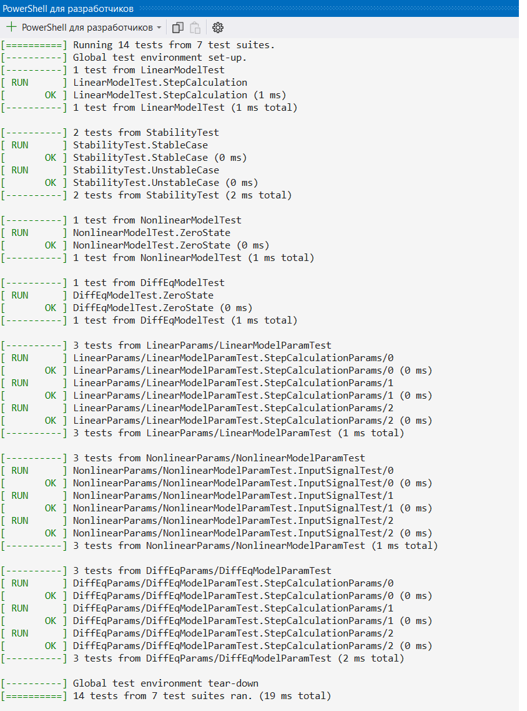
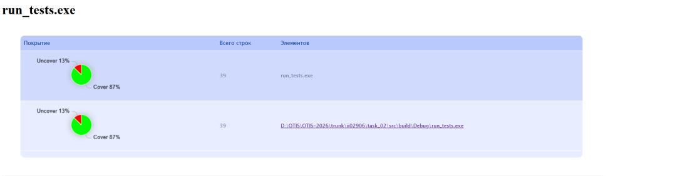
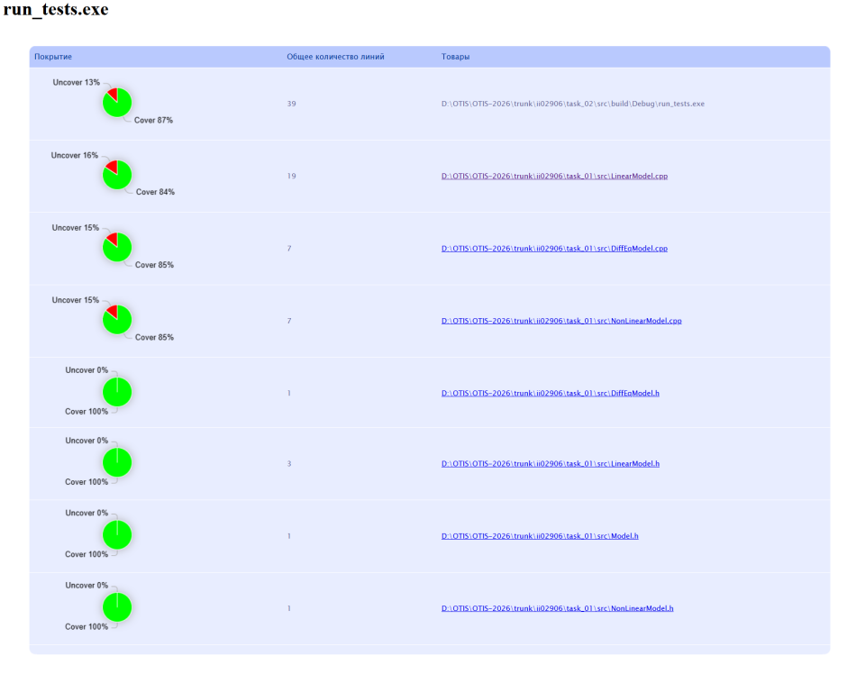

 Министерство образования Республики Беларусь

Учреждение образования

“Брестский Государственный технический университет”

Кафедра ИИТ

       

Лабораторная работа №2

По дисциплине “Общая теория интеллектуальных систем”

Тема: “Тестирование программы и анализ покрытия кода”

     

Выполнила:

Студентка 2 курса

Группы ИИ-29

Дешунина А.Ю.

Проверил:

Дворанинович Д. А.

   

Брест 2026

---

# Лабораторная работа №2

**Вариант:** 16

## PITCHING

В рамках первой лабораторной работы мною были разработаны три математические модели — линейная, нелинейная и модель дифференциального уравнения — и реализована их симуляция. Однако на тот момент корректность их работы не была подтверждена автоматическими проверками.

Во второй лабораторной работе я поставила задачу верифицировать этот код. Для этого я применила фреймворк модульного тестирования Google Test и реализовала два уровня проверок. Первый — базовые тесты, валидирующие корректность вычисления шага и устойчивость системы. Второй — параметризованные тесты (`TEST_P`), которые позволили прогнать модели через множество наборов коэффициентов и входных сигналов без дублирования кода. Это дало возможность проверить поведение системы в широком диапазоне условий, включая граничные случаи.

Кроме того, я автоматизировала процесс сборки и верификации. С помощью CMake проект разделён на библиотеку моделей и исполняемый файл тестов. Запуск осуществляется через bat-скрипт, который собирает проект, запускает все 14 тестов и автоматически формирует отчёт о покрытии кода с помощью OpenCppCoverage.

Результат: все тесты проходят, покрытие кода составляет 89%. Это означает, что код из первой лабораторной прошёл верификацию, а процесс тестирования полностью автоматизирован и воспроизводим.

## Цель работы
Изучение методов тестирования программного обеспечения, освоение библиотеки Google Test для написания модульных тестов, а также анализ покрытия кода с помощью инструмента OpenCppCoverage.

## Тестирование программы

Для тестирования использовалась библиотека **Google Test**. Написаны базовые и параметризованные тесты (`TEST_P`), покрывающие расчеты, устойчивость, граничные значения и подмену входных сигналов (пункт 9).

**Результат выполнения тестов:**

## Покрытие кода

Покрытие замерено с помощью инструмента **OpenCppCoverage**.

**Общее покрытие:**

**Детализация по файлам:**

### Таблица покрытия

- **Способ запуска:** Локальный скрипт (`run_lab2.bat`)
- **Всего модульных тестов:** 14
- **Успешно пройденных тестов:** 14 / 14

| Модуль / Класс | Покрытие строк (Line Coverage) | Статус |
| :--- | :--- | :--- |
| `LinearModel.cpp` | 84 % | OK |
| `NonLinearModel.cpp` | 85 % | OK |
| `DiffEqModel.cpp` | 85 % | OK |
| `LinearModel.h` | 100 % | OK |
| `NonLinearModel.h` | 100 % | OK |
| `DiffEqModel.h` | 100 % | OK |
| `Model.h` | 100 % | OK |
| **Итоговый результат** | **87 %** | **Success** |

## Структура проекта

Проект организован следующим образом:
- `src/` — исходный код моделей (LinearModel, NonLinearModel, DiffEqModel).
- `test/` — файл `test_models.cpp` с тестами Google Test.
- `doc/` — отчетная документация и скриншоты.

## Особенности реализации тестов

В рамках лабораторной работы были реализованы следующие виды проверок:
1. **Базовые тесты** для проверки корректности расчетов шага модели.
2. **Тесты на устойчивость** (метод `isStable()`), проверяющие как стабильные, так и нестабильные конфигурации.
3. **Параметризованные тесты (`TEST_P`)** для проверки моделей при различных входных коэффициентах.
4. **Подмена входных сигналов** (ступенчатый, импульсный, гармонический) для проверки реакции системы на разные воздействия.

## Вывод

В ходе выполнения лабораторной работы №2 (вариант 16) были освоены навыки написания модульных тестов с использованием фреймворка Google Test. Проведен анализ покрытия кода с помощью OpenCppCoverage, который показал 87% покрытия. Все 14 тестов успешно пройдены, что подтверждает корректность работы реализованных моделей.