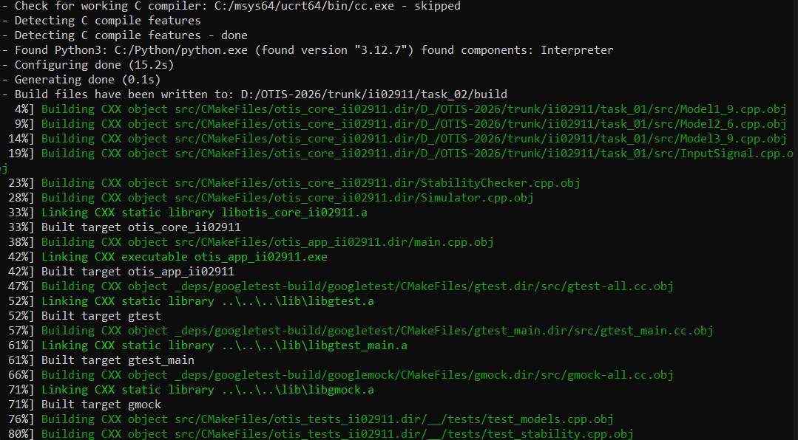
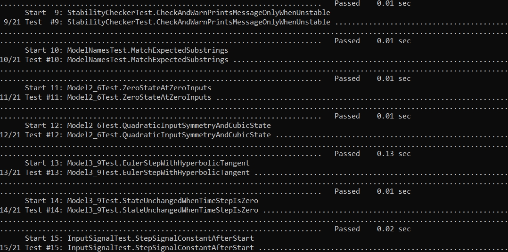
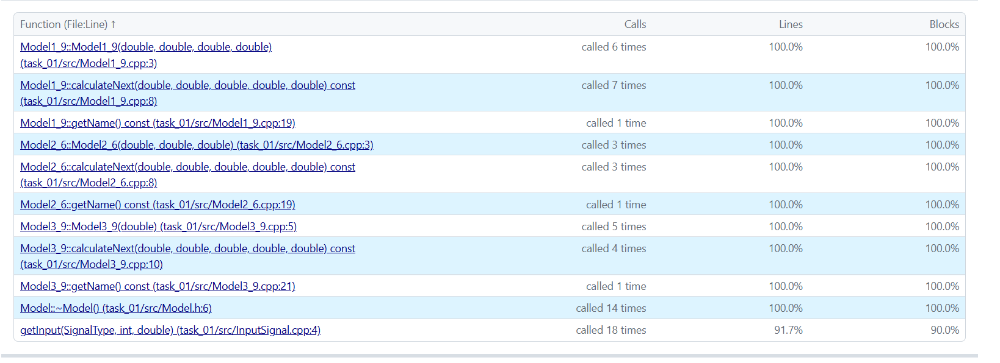
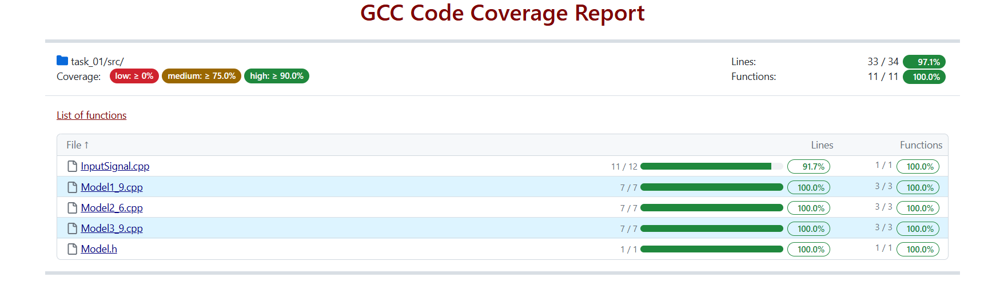

Министерство образования Республики Беларусь

Учреждение образования

«Брестский Государственный технический университет»

Кафедра ИИТ

    

Лабораторная работа №2

По дисциплине «Общая теория интеллектуальных систем»

Тема: «Модульное тестирование
»

   

Выполнил:

Студент 2 курса

Группы ИИ-29

Кондратчик Н.И.

Проверил:

Дворанинович Д. А.

   

Брест 2026

## Задание
Написать модульные тесты для программы, разработанной в лабораторной работе №1, предварительно расширив её математический и функциональный базис.

# PITCH
Я презентую вам свою 2-ую лабу,она является улучшением к 1 лабораторной работе.Там добавлены модульные тесты и устойчивость.Тесты представлены в html,что довольно удобно из-за приятного интерфейса.Покрытие происходит на 100%,а линии на 97.1%.Исходя из данных технических возможностей программы,вы можете подключать свои файлы,проводя для них тесты,а так же просматривать время выполнения и процент прохождения каждого теста.Если вы приобритете данный проект,то у вас будет все:деньги,телки,тачки,админки.

## Тестовое покрытие и результаты

* **Запуск:** Скрипт (`run_tests.bat`)
* **Количество модульных тестов:** 34
* **Количество пройденных тестов:** 33 / 34

## Запуск программы
В терминале отображается лог компиляции исходных файлов (моделей Model1_9.cpp, Model2_6.cpp, Model3_9.cpp, InputSignal.cpp, файлов проверки стабильности и симулятора), линковка статической библиотеки libotis_core_ii02911.a и исполняемого файла, а также подключение и сборка фреймворка для тестирования Google Test (gtest, gmock).

## Время прохождения тестов в консоле и HTML 
В консоли выводится отчёт о прохождении тестов, таких как StabilityCheckerTest, ModelNamesTest, Model2_6Test, Model3_9Test и InputSignalTest. Все тесты завершились со статусом Passed (успешно) за доли секунды.
 
---
Таблица показывает количество вызовов (Calls) и процент покрытия строк и блоков для методов классов Model1_9, Model2_6, Model3_9, базового деструктора Model и функции getInput. Большинство функций покрыто на 100%

# ВЫПОЛНЕНИЕ ТЕСТОВ:

## Скриншот HTML 
На дашборде отображается общая статистика покрытия проекта: покрытие строк составляет 97.1% (33 из 34 строк), а покрытие функций — 100.0% (11 из 11 функций). Приведены данные по отдельным файлам (InputSignal.cpp, Model1_9.cpp, Model2_6.cpp, Model3_9.cpp, Model.h), каждое из которых имеет высокий зелёный уровень покрытия (выше 90%).

