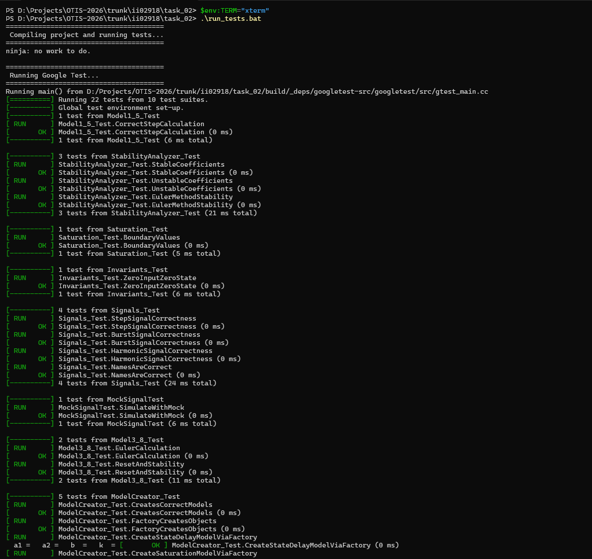
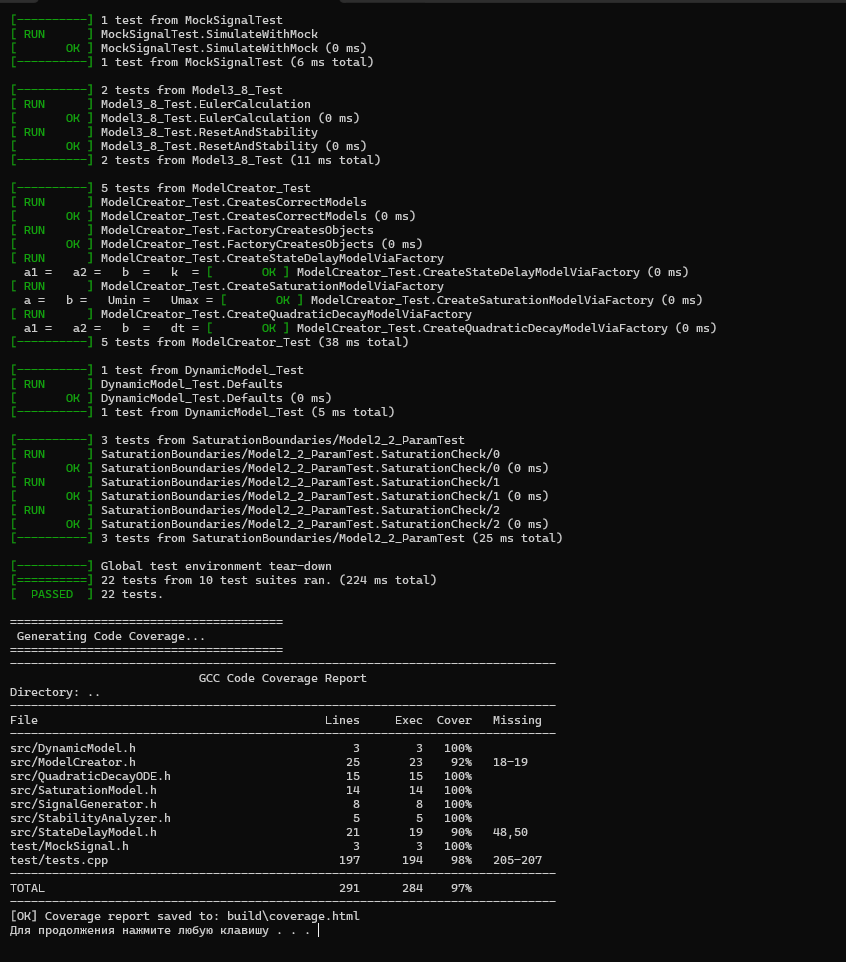
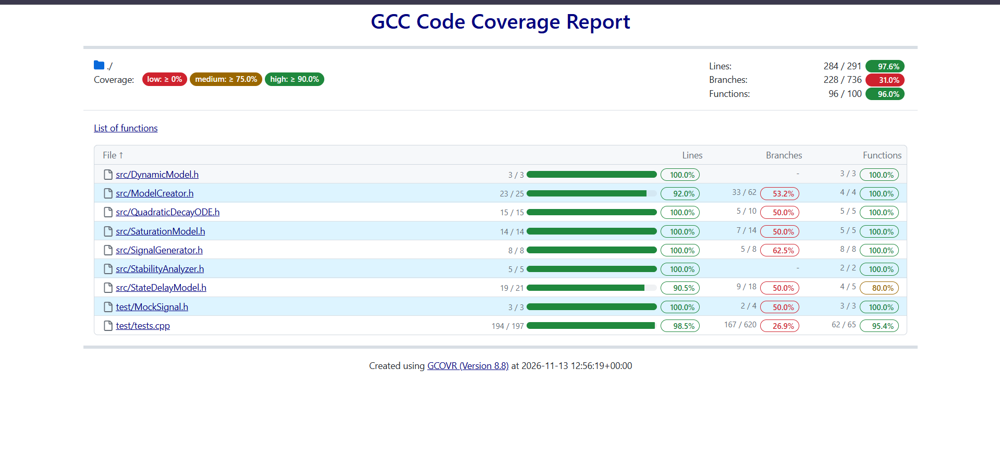

Министерство образования Республики Беларусь

Учреждение образования

«Брестский государственный технический университет»

Кафедра ИИТ

       

Лабораторная работа №2

По дисциплине «Общая теория интеллектуальных систем»

Тема: «Модульное тестирование программного обеспечения»

     

Выполнил:

Студент 2 курса

Группы ИИ-29

Пархоц В.В.

Проверил:

Дворанинович Д.А.

     

Брест 2026

---

## Задание: 
1. Использовать следующий фреймворк для модульного тестирования — Google Test.

2. Анализ устойчивости систем: Для выбранных линейных дискретных моделей (из блока 1 ЛР №1) аналитически определить критерий устойчивости (найти корни характеристического уравнения на Z-плоскости). В исходном коде программы реализовать логическую проверку: если заданные пользователем коэффициенты 
a~i~
 приводят к расходящемуся (неустойчивому) процессу, программа должна выводить предупреждение в консоль перед началом симуляции.
3. Исходный код модифицированной программы (включая модуль анализа устойчивости) разместить в каталоге: trunk\ii0xxyy\task_02\src.

4. Написать модульные тесты для основных функций программы согласно своему варианту, а также для разработанного модуля анализа устойчивости. Разместить тесты в каталоге: trunk\ii0xxyy\task_02\test.

5. [Локальная автоматизация]: Создать в корне проекта командный файл Windows (run_tests.bat). Этот файл должен автоматически компилировать проект, запускать модульные тесты на локальном компьютере и генерировать отчет о прохождении тестов.

6. В файле readme.md отразить количество написанных тестов и процент покрытия кода тестами (использовать любой инструмент для анализа покрытия, например, gcovr или LCOV).

7. Отразить выполнение работы в общем файле readme.md в соответствующей строке.

8. Архитектурное требование к тестам: для проверки расчета шагов симуляции использовать параметризованные тесты (TEST_P) в Google Test, чтобы протестировать сходимость алгоритмов при различных входных наборах данных без дублирования кода.

9. Использовать mock-объекты (Google Mock) или подмену входных сигналов для тестирования различных режимов управления (ступенчатый, импульсный, гармоническое воздействие).

## Цель работы:
Написание модульных тестов для программы из ЛР1 и настройка автоматического подсчета покрытия кода тестами.

## Pitch:
В рамках первой лабораторной работы был разработан готовый программный продукт для моделирования управляемых объектов. Однако любой программный продукт со временем требует расширения функционала. В будущем у пользователя, купившего этот продукт, возникнет желание добавить новые модели, сигналы или методы анализа. 

Чтобы гарантировать, что при добавлении нового кода старые математические расчеты не сломаются, необходимо внедрить систему автоматического тестирования. Благодаря **модульным тестам** можно корректно и своевременно выявлять все возможные проблемы как в исходном, так и в будущем коде.

## Тестовое покрытие и результаты

* **Способ запуска:** Локальный скрипт (`run_tests.bat`)
* **Всего модульных тестов:** 22
* **Успешно пройденных тестов:** 22 / 22

| Модуль / Класс | Покрытие строк (Line Coverage) | Покрытие функций (Func Coverage) | Статус |
| :--- | :--- | :--- | :--- |
| `src/DynamicModel.h` | 100.0 % | 100.0 % | OK |
| `src/ModelCreator.h` | 92.0 % | 100.0 % | OK |
| `src/QuadraticDecayODE.h` | 100.0 % | 100.0 % | OK |
| `src/SaturationModel.h` | 100.0 % | 100.0 % | OK |
| `src/SignalGenerator.h` | 100.0 % | 100.0 % | OK |
| `src/StabilityAnalyzer.h` | 100.0 % | 100.0 % | OK |
| `src/StateDelayModel.h` | 90.0 % | 100.0 % | OK |
| `test/MockSignal.h` | 100.0 % | 100.0 % | OK |
| `test/tests.cpp` | 98.0 % | 100.0 % | OK |
| **Итоговый результат** | **97.0 %** | **100.0 %** | **Success** |

*Для просмотра подробного интерактивного отчета с исходным кодом откройте файл `build/coverage.html` в браузере.*

---

### Доказательства выполнения тестов

**Скриншот консоли (часть 1, прохождение Google Test):**

**Скриншот консоли (часть 2, итоговый результат):**

**Скриншот отчета о покрытии (HTML):**

