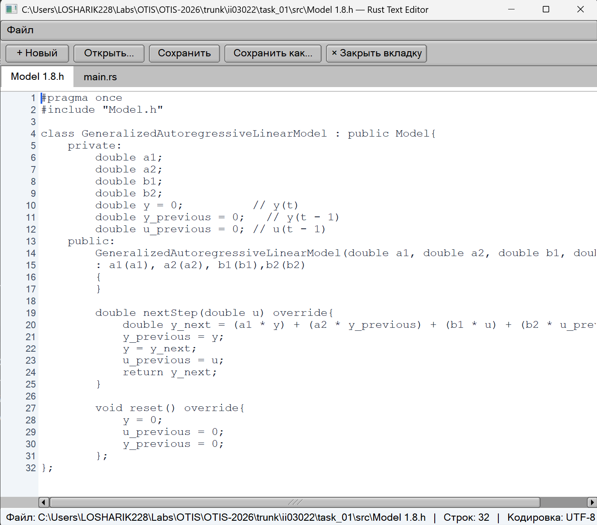
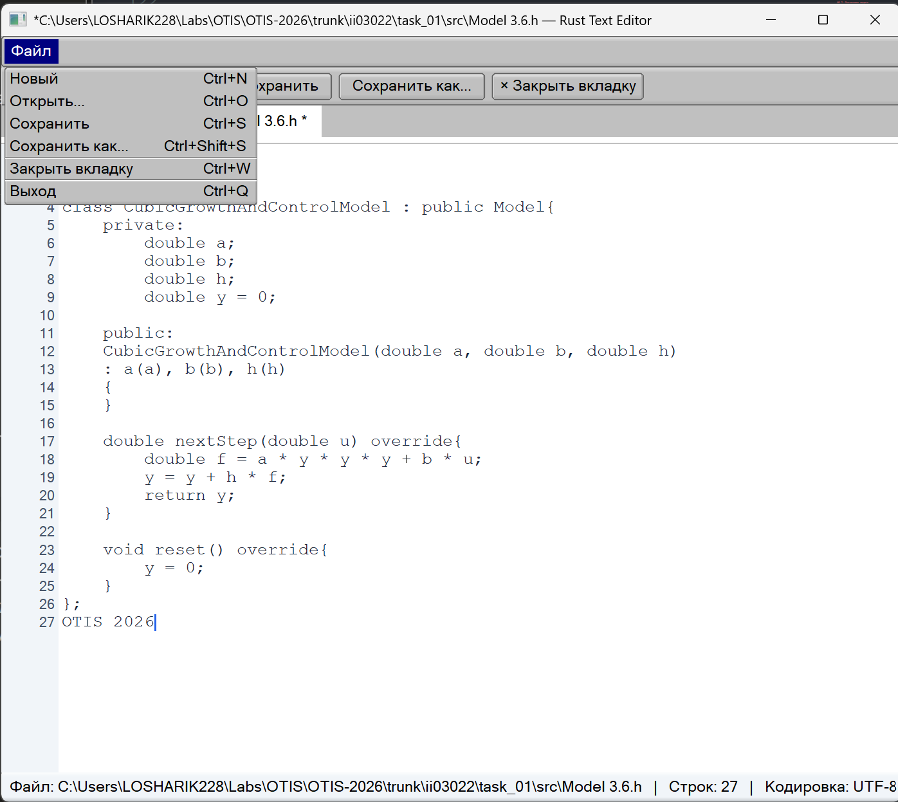
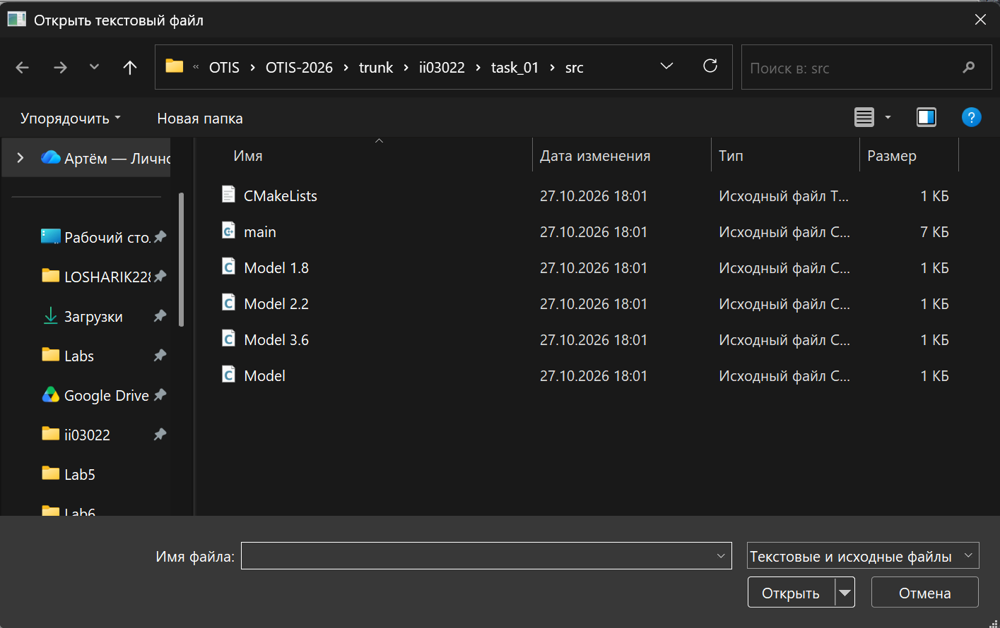
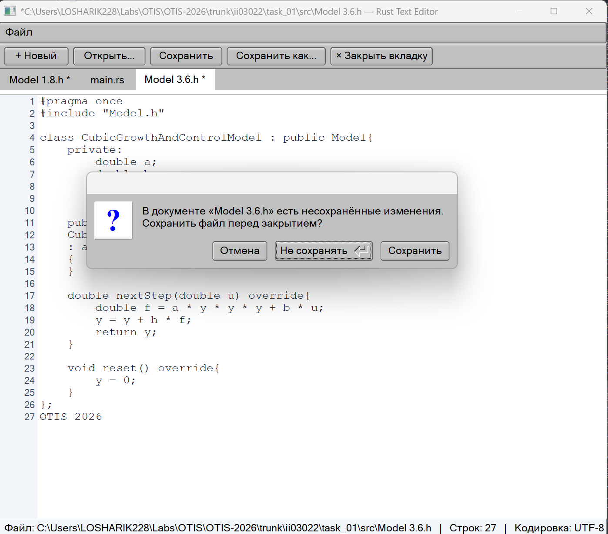
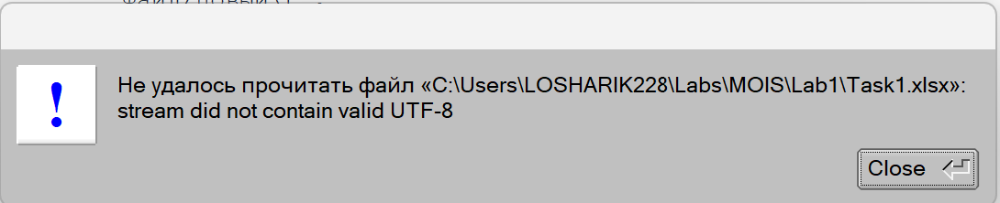
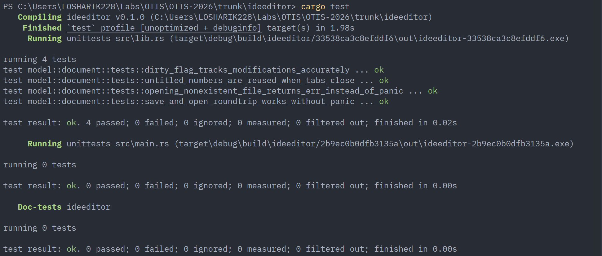

<p align="center">Учреждение образования</p>
<p align="center">“Брестский Государственный технический университет”</p>
<p align="center">Кафедра ИИТ</p>
<br><br><br><br><br><br><br>
<p align="center">Лабораторная работа №4</p>
<p align="center">По дисциплине “Общая теория интеллектуальных систем”</p>
<p align="center">Тема: “Разработка текстового редактора. Стадия 1: GUI, работа с файлами и нумерация строк”</p>
<br><br><br><br><br>
<p align="right">Выполнил:</p>
<p align="right">Студент 2 курса</p>
<p align="right">Группы ИИ-30</p>
<p align="right">Семенюк А. С.</p>
<p align="right">Проверил:</p>
<p align="right">Дворанинович Д. А.</p>
<br><br><br><br><br>
<p align="center">Брест 2026</p>


---

## 1. Цель работы
Изучить принципы построения графических интерфейсов пользователя (GUI), механизмы обработки системных событий и кроссплатформенную работу с файловой системой на языке программирования Rust с использованием библиотеки `fltk` (`fltk-rs`).

---

## 2. Постановка задачи

В рамках первой стадии разработки текстового редактора реализованы **все базовые и продвинутые требования**:

1. **Каркас GUI-интерфейса (`fltk-rs`):**
   * Главное масштабируемое окно приложения.
   * Главное меню **«Файл»**: *Новый (`Ctrl+N`), Открыть (`Ctrl+O`), Сохранить (`Ctrl+S`), Сохранить как (`Ctrl+Shift+S`), Закрыть вкладку (`Ctrl+W`), Выход (`Ctrl+Q`)*, а также панель инструментов быстрого доступа.
   * Многострочная область редактирования текста на базе `TextEditor` и `TextBuffer`.
   * Динамическая статусная строка (`Status Bar`) с отображением полного пути к открытому файлу, количества строк, кодировки (`UTF-8`) и текущих координат курсора (`Стр`, `Стб`).
2. **Панель нумерации строк:**
   * Вертикальная полоса номеров строк слева от текстового поля, строго синхронизированная с вертикальной прокруткой (`scrolling`) и автоматически расширяющаяся при увеличении объёма документа (1000+, 10000+ строк).
3. **Кроссплатформенная работа с файловой системой:**
   * Интеграция стандартных системных диалогов `fltk::dialog::FileDialog` для открытия и сохранения файлов.
   * Безопасная обработка ошибок ввода-вывода через типы `Result` и `Option` без использования `unwrap()` и аварийных остановок `panic!`.
4. **Управление состоянием документа (`State Management`):**
   * Отслеживание модификации текста с динамическим выводом символа `*` в заголовке главного окна и на ярлычке вкладки.
   * Перехват закрытия вкладки и главного окна (`Event::Close`) с выводом диалогового предупреждения при наличии несохранённых изменений.
5. **Многовкладочный интерфейс (`Tabs` — продвинутый уровень):**
   * Одновременное открытие и редактирование нескольких файлов в контейнере `fltk::group::Tabs` с изолированным хранением пути к файлу, текста, позиции курсора и флага изменённости для каждой вкладки.
6. **Локальная автоматизация:**
   * Командный сценарий Windows `run_editor_base.bat` для автоматической компиляции и запуска редактора.

---

## 3. Архитектура и структура проекта

В проекте сразу заложено разделение на независимый слой бизнес-логики (**Domain Model**) и слой графического интерфейса (**UI**), связанные через типизированный канал событий `fltk::app::channel::<AppMsg>()`:

```text
ideeditor/
├── Cargo.toml                  # Конфигурация пакета и зависимость fltk (fltk-bundled)
├── run_editor_base.bat         # Скрипт автоматической сборки и запуска (Windows)
│  
└── src/
    ├── lib.rs                  # Точка входа библиотечного крейта
    ├── main.rs                 # Главное окно, меню, контроллер событий AppMsg и диалоги
    ├── model/
    │   ├── mod.rs
    │   └── document.rs         # Бизнес-логика: структуры Document и Workspace + Unit-тесты
    └── ui/
        ├── mod.rs
        └── editor_tab.rs       # Виджет вкладки редактора, TextBuffer и панель номеров строк
```

---

## 4. Описание ключевых проектных решений

### 4.1. Изолированное хранение состояния вкладок (`Document` и `Workspace`)
Модуль `src/model/document.rs` не зависит от библиотеки `fltk`. Каждая открытая вкладка представлена структурой `Document`, которая хранит уникальный идентификатор сессии `id`, путь на диске `Option<PathBuf>`, сохранённую копию текста `saved_content`, текущий текст `current_content`, байтовую позицию курсора `cursor_pos` и флаг модификации `is_dirty`:

```rust
pub fn update_text(&mut self, new_text: String) {
    self.is_dirty = new_text != self.saved_content;
    self.current_content = new_text;
}
```
Сравнение с последним сохранённым состоянием гарантирует точность индикатора `*`: если пользователь внёс правку, а затем вернул текст к исходному виду, флаг `is_dirty` автоматически сбрасывается. Менеджер `Workspace` управляет списком всех вкладок и переиспользует освободившиеся номера для новых документов (`Без имени 1`, `Без имени 2` и т.д.).

### 4.2. Безопасный файловый ввод-вывод без `panic!`
Чтение и запись файлов выполняются через `std::fs::read_to_string` и `std::fs::write` с преобразованием системных ошибок `io::Error` в человекочитаемое описание `Result<..., String>`:

```rust
pub fn open_from_path(id: usize, path: impl AsRef<Path>) -> Result<Self, String> {
    let path_buf = path.as_ref().to_path_buf();
    let content = fs::read_to_string(&path_buf).map_err(|err| {
        format!("Не удалось прочитать файл «{}»:\n{}", path_buf.display(), err)
    })?;
    // ...
}
```
При попытке открыть повреждённый, недоступный или бинарный (не UTF-8) файл приложение не завершается аварийно, а выводит модальное окно предупреждения `dialog::alert_default`.

### 4.3. Текстовый буфер, нумерация строк и работа с UTF-8
Визуальный компонент вкладки `EditorTab` (`src/ui/editor_tab.rs`) использует связку виджета `TextEditor` и буфера `TextBuffer` (внутри реализованного по принципу структуры данных **Gap Buffer**). Левая полоса нумерации строк синхронизирована с областью отображения текста при вертикальной прокрутке, а метод `adjust_gutter_width()` динамически пересчитывает её ширину в зависимости от разрядности общего числа строк.

Для корректного отображения столбца курсора при работе с кириллицей в кодировке UTF-8 индекс столбца вычисляется по количеству символов Юникода (`.chars().count()`), а не байтов:

```rust
pub fn cursor_line_col(&self) -> (usize, usize) {
    let pos = self.editor.insert_position().max(0);
    let line = (self.buffer.count_lines(0, pos) + 1) as usize;
    let line_start = self.editor.line_start(pos);
    let col = self
        .buffer
        .text_range(line_start, pos)
        .map(|s| s.chars().count() + 1)
        .unwrap_or(1);
    (line, col)
}
```

### 4.4. Перехват закрытия окна и защита несохранённых данных
На главное окно установлен пользовательский обработчик `wind.set_callback`, который блокирует случайное закрытие окна по клавише `Esc` и перенаправляет событие `Event::Close` в очередь `AppMsg::AppExit`. Перед закрытием вкладки или завершением работы программа опрашивает все модифицированные вкладки через диалог `dialog::choice2_default` (*«Сохранить» / «Не сохранять» / «Отмена»*).

---

## 5. Результаты работы программы

### 5.1. Главное окно, многовкладочный режим и синхронизация нумерации строк
На рисунке 1 представлено главное окно текстового редактора с несколькими открытыми вкладками в контейнере `Tabs`, синхронизированной панелью нумерации строк при вертикальной прокрутке файла и информационной строкой состояния внизу окна.


*Рисунок 1 — Главное окно текстового редактора с открытыми вкладками и нумерацией строк*

### 5.2. Главное меню «Файл» и индикация несохранённых изменений (`*`)
При внесении изменений в документ в заголовке главного окна и на ярлычке соответствующей вкладки динамически отображается маркер модификации `*` (рисунок 2).


*Рисунок 2 — Раздел меню «Файл» и отображение символа `*` при редактировании текста*

### 5.3. Открытие и сохранение файлов через `FileDialog`
Интеграция системного диалогового окна выбора и сохранения файлов показана на рисунке 3.


*Рисунок 3 — Диалоговое окно `FileDialog` при работе с файловой системой*

### 5.4. Защита от потери данных и безопасная обработка ошибок ввода-вывода
При попытке закрыть изменённую вкладку или само окно редактора выводится предупреждение с предложением сохранить изменения (рисунок 4). При попытке чтения файла в неподдерживаемой кодировке программа перехватывает `Err` и выводит окно с описанием ошибки без вызова `panic!`.


*Рисунок 4 — Предупреждение о несохранённых изменениях при закрытии документа*


*Рисунок 5 — Перехват ошибки чтения некорректного файла без аварийного завершения*

### 5.5. Модульное тестирование и скрипт автоматизации
Результаты запуска модульных тестов слоя бизнес-логики (`cargo test`) и работы командного файла `run_editor_base.bat` приведены на рисунке 6.


*Рисунок 6 — Успешное прохождение Unit-тестов и запуск через `run_editor_base.bat`*

---

## 6. Вывод
В ходе выполнения лабораторной работы были изучены принципы построения событийно-ориентированных графических интерфейсов на языке Rust с применением библиотеки `fltk-rs`. Разработана первая стадия многовкладочного текстового редактора с разделением на слой предметной логики (`Document`, `Workspace`) и визуальный интерфейс (`EditorTab`, `Tabs`). Реализованы синхронизированная с прокруткой панель нумерации строк, кроссплатформенная работа с файлами в кодировке UTF-8 через системные диалоги `FileDialog`, безопасная обработка ошибок ввода-вывода на базе типов `Result` и `Option`, а также контроль несохранённых изменений при закрытии вкладок и приложения.
