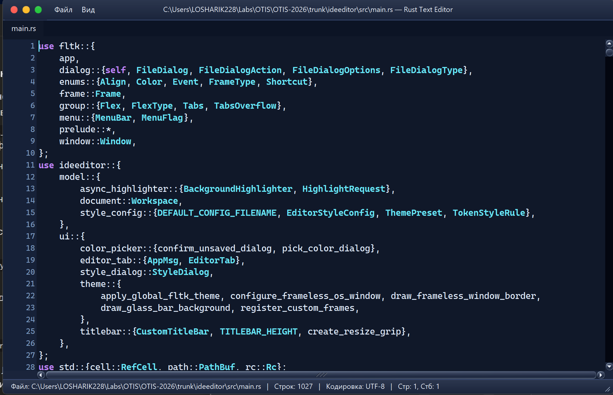
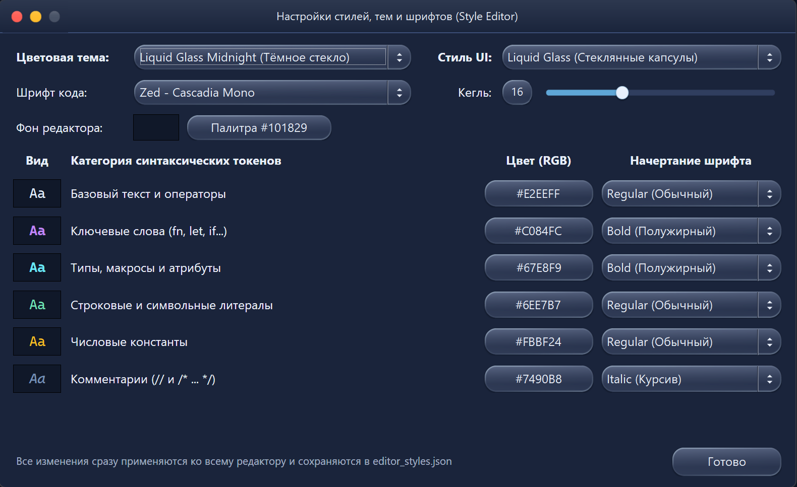
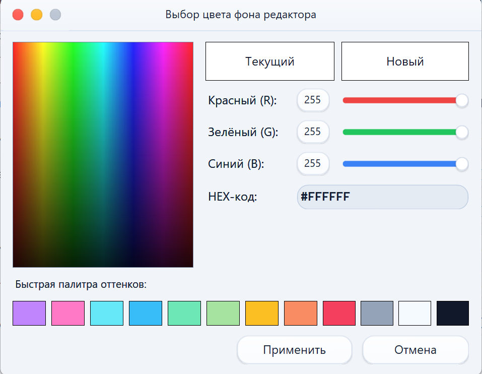
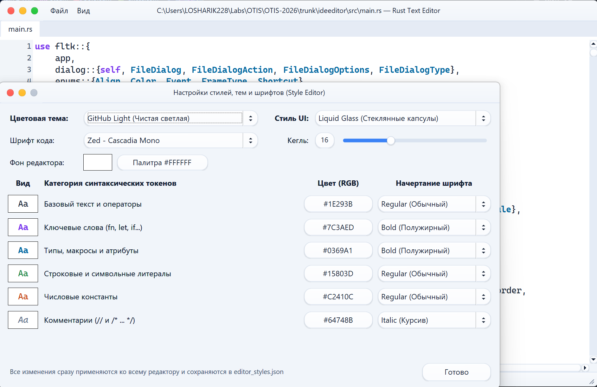
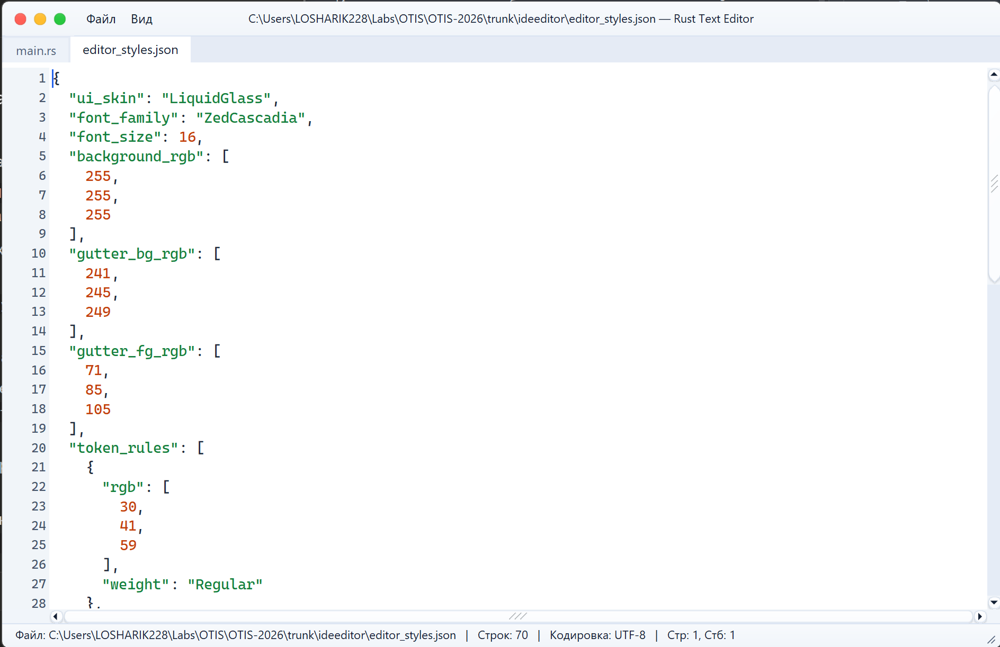
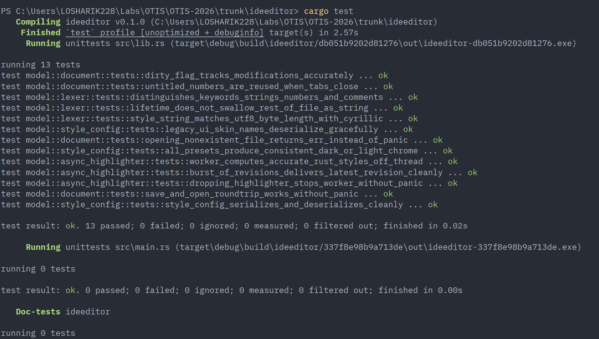

<p align="center">Учреждение образования</p>
<p align="center">“Брестский Государственный технический университет”</p>
<p align="center">Кафедра ИИТ</p>
<br><br><br><br><br><br><br>
<p align="center">Лабораторная работа №5</p>
<p align="center">По дисциплине “Общая теория интеллектуальных систем”</p>
<p align="center">Тема: “Разработка текстового редактора. Стадия 2: Подсветка синтаксиса и интерактивный редактор стилей”</p>
<br><br><br><br><br>
<p align="right">Выполнил:</p>
<p align="right">Студент 2 курса</p>
<p align="right">Группы ИИ-30</p>
<p align="right">Семенюк А. С.</p>
<p align="right">Проверил:</p>
<p align="right">Дворанинович Д. А.</p>
<br><br><br><br><br>
<p align="center">Брест 2026</p>


---

## 1. Цель работы
Изучить продвинутую работу со строками, лексический анализ текста в реальном времени, механизмы динамической стилизации текстовых буферов и проектирование кастомных конфигурационных GUI-интерфейсов на языке программирования Rust с использованием библиотеки `fltk` (`fltk-rs`).

---

## 2. Постановка задачи

В рамках второй стадии разработки текстового редактора реализованы **все базовые и продвинутые требования**:

1. **Динамическая подсветка синтаксиса в реальном времени (язык Rust):**
   * Автоматический лексический разбор исходного кода при редактировании и открытии файлов.
   * Выделение **6 независимых категорий токенов** (превышает минимальное требование в 4 стиля):
     1. *Базовый текст, идентификаторы и операторы (`Plain`)*;
     2. *Ключевые слова управляющих конструкций и деклараций (`Keyword`: `fn`, `let`, `mut`, `match`, `impl`, `pub`, `async` и др.)*;
     3. *Встроенные и пользовательские типы данных, макросы и атрибуты (`TypeOrMacro`: `i32`, `usize`, `String`, `Vec`, `Result`, `println!`, `#[derive(...)]`)*;
     4. *Строковые, сырые (`r#"..."#`) и символьные литералы (`StringLiteral`), с корректным различением времён жизни `'a`, `'static`*;
     5. *Десятичные, шестнадцатеричные (`0x`), двоичные (`0b`), восьмеричные (`0o`) и вещественные числовые константы (`NumberLiteral`)*;
     6. *Однострочные (`//`) и вложенные многострочные (`/* ... */`) комментарии (`Comment`)*.
   * Использование параллельной связки основного текстового буфера (`TextBuffer`) и буфера стилей (`HighlightBuf`).
2. **Интерактивный редактор стилей (`Style Editor`):**
   * Немодальное GUI-окно настройки оформления (`Вид -> Настройки стилей и шрифтов...` / `Ctrl+Shift+T`), а также быстрое переключение готовых цветовых пресетов из меню `Вид`.
   * Интерактивный выбор цвета (`RGB` / `HEX` через кастомную палитру) и начертания шрифта (`Regular`, `Bold`, `Italic`, `BoldItalic`) для каждой категории токенов, выбор базового семейства шрифта и кегля (`10..28 pt`), а также переключение визуального скина интерфейса (`Liquid Glass` / `Базовый минималистичный IDE`).
   * Мгновенное применение всех изменений ко всем открытым вкладкам и элементам окна редактора.
3. **Сохранение конфигурации между запусками:**
   * Автоматическая сериализация и десериализация пользовательской конфигурации в файл `editor_styles.json` с помощью библиотек `serde` и `serde_json`.
   * Автоматическое считывание `editor_styles.json` при старте приложения и сохранение при каждом изменении настроек.
4. **Асинхронный фоновый парсинг (Продвинутый уровень — Фоновый лексер):**
   * Вынос лексического анализа и расчёта буфера стилей в выделенный рабочий поток ОС (`std::thread`) для полного исключения задержек GUI при редактировании больших файлов.
   * Потокобезопасный обмен заданиями и результатами разметки через каналы `std::sync::mpsc` с фильтрацией устаревших ревизий документа и схлопыванием серий быстрых нажатий клавиш.
5. **Локальная автоматизация:**
   * Командный сценарий Windows `run_editor_highlighter.bat` для автоматической сборки и запуска обновлённой версии редактора.

---

## 3. Архитектура и структура проекта

Архитектура проекта строго следует принципу разделения **Model — View — Controller (MVC)**: модули в каталоге `src/model/` не имеют зависимостей от графической библиотеки `fltk`, полностью покрыты модульными тестами и взаимодействуют с главным потоком интерфейса через типизированные каналы сообщений:

```text
ideeditor/
├── Cargo.toml                  # Зависимости пакета: fltk (fltk-bundled), serde, serde_json
├── run_editor_base.bat         # Скрипт запуска базовой версии (Стадия 1)
├── run_editor_highlighter.bat  # Скрипт сборки и запуска версии с подсветкой (Стадия 2)
└── src/
    ├── lib.rs                  # Корневой библиотечный модуль
    ├── main.rs                 # Контроллер событий AppMsg, связка GUI и фонового лексера
    ├── model/
    │   ├── mod.rs
    │   ├── document.rs         # Состояние вкладок Document (с номером ревизии) и Workspace
    │   ├── lexer.rs            # Конечный автомат лексического анализатора языка Rust
    │   ├── async_highlighter.rs# Фоновый поток лексера (std::thread + std::sync::mpsc)
    │   └── style_config.rs     # Модель тем, шрифтов, стилей токенов и JSON-сериализация
    └── ui/
        ├── mod.rs
        ├── editor_tab.rs       # Связка TextBuffer + HighlightBuf и таблица StyleTableEntry
        ├── style_dialog.rs     # Интерактивное окно настройки стилей и шрифтов (Style Editor)
        ├── color_picker.rs     # Кастомный диалог выбора цвета RGB/HEX и диалоги подтверждений
        ├── titlebar.rs         # Кастомная шапка окна с HiDPI-кнопками управления
        └── theme.rs            # Движок тем, шрифтов и SDF-отрисовки элементов интерфейса
```

---

## 4. Описание ключевых проектных решений

### 4.1. Конечный автомат лексического анализатора и побайтовая синхронизация с UTF-8
В `fltk-rs` буфер подсветки `HighlightBuf` сопоставляется с основным буфером `TextBuffer` строго **побайтово**: каждому байту исходного текста в кодировке UTF-8 должен соответствовать один ASCII-символ индекса стиля (`'A'`..`'F'`). Поэтому в модуле `src/model/lexer.rs` реализован однопроходный лексический анализатор по срезу байтов `&[u8]`, который заполняет выходной буфер `vec![b'A'; bytes.len()]`:

```rust
#[derive(Debug, Clone, Copy, PartialEq, Eq, Serialize, Deserialize)]
pub enum TokenCategory {
    Plain = 0,         // 'A' — базовый текст и операторы
    Keyword = 1,       // 'B' — ключевые слова Rust
    TypeOrMacro = 2,   // 'C' — типы данных, макросы (println!) и атрибуты (#[...])
    StringLiteral = 3, // 'D' — строковые, сырые (r#"..."#) и символьные литералы
    NumberLiteral = 4, // 'E' — числовые константы (10, 0xFF, 0b1010, 3.14e-2)
    Comment = 5,       // 'F' — однострочные // и вложенные блочные /* ... */ комментарии
}
```
Анализатор корректно обрабатывает вложенные блочные комментарии Rust (`/* ... /* ... */ ... */`), сырые строки с произвольным числом символов `#`, а также отличает символьные литералы `'x'` от параметров времени жизни `'a` и `'static`, не нарушая выравнивание многобайтовых символов кириллицы в UTF-8.

### 4.2. Асинхронный фоновый лексер (`std::thread` + `std::sync::mpsc`)
Для предотвращения блокировки главного GUI-потока на крупных исходных файлах в модуле `src/model/async_highlighter.rs` реализован менеджер `BackgroundHighlighter`, запускающий отдельный поток `ideeditor-lexer-worker` и две пары каналов `mpsc::channel`:

```rust
while let Ok(first_req) = req_rx.recv() {
    let mut latest_by_doc: BTreeMap<usize, HighlightRequest> = BTreeMap::new();
    latest_by_doc.insert(first_req.doc_id, first_req);

    // Коалесценция: если скопилась очередь нажатий клавиш, разбираем только последнюю ревизию
    for pending in req_rx.try_iter() {
        match latest_by_doc.get(&pending.doc_id) {
            Some(existing) if existing.revision > pending.revision => {}
            _ => { latest_by_doc.insert(pending.doc_id, pending); }
        }
    }

    for (_doc_id, req) in latest_by_doc {
        let style_string = highlight_rust_to_style_string(&req.text);
        let _ = resp_tx.send(HighlightResponse {
            doc_id: req.doc_id,
            revision: req.revision,
            style_string,
        });
        on_ready();
    }
}
```
При вводе символа в `EditorTab` обработчик `add_modify_callback` за $O(1)$ выравнивает длину `style_buffer` с `buffer` (чтобы существующая подсветка ниже курсора не смещалась ни на один кадр), увеличивает номер ревизии `doc.revision` и отправляет текст в рабочий поток. По готовности рабочий поток пробуждает цикл событий FLTK сообщением `AppMsg::HighlightReady`, и главный поток применяет разметку только при точном совпадении `doc.revision == resp.revision`. Реализация типажа `Drop` для `BackgroundHighlighter` закрывает канал и дожидается штатного завершения потока через `JoinHandle::join()`.

### 4.3. Интерактивный редактор стилей и сериализация в `editor_styles.json`
Структура `EditorStyleConfig` (`src/model/style_config.rs`) объединяет выбранный скин интерфейса (`LiquidGlass` или `BasicFlat`), семейство моноширинного шрифта, кегль, цвет фона и правила `TokenStyleRule` для всех 6 категорий токенов. При любом изменении настроек в немодальном окне `StyleDialog` вызывается функция `apply_and_persist_styles`, которая перестраивает таблицу `Vec<StyleTableEntry>`, мгновенно перекрашивает открытые вкладки и сохраняет конфигурацию на диск в человекочитаемом формате JSON:

```rust
pub fn save_to_file(&self, path: impl AsRef<Path>) -> Result<(), String> {
    let json = serde_json::to_string_pretty(self)
        .map_err(|e| format!("Ошибка сериализации настроек стилей: {}", e))?;
    fs::write(path.as_ref(), json).map_err(|e| {
        format!("Не удалось записать файл конфигурации «{}»:\n{}", path.as_ref().display(), e)
    })
}
```

---

## 5. Результаты работы программы

### 5.1. Динамическая подсветка синтаксиса Rust в реальном времени
На рисунке 1 показано главное окно редактора с открытым исходным файлом на языке Rust: ключевые слова, типы, макросы, строковые и числовые константы, а также комментарии выделяются различными цветами и начертаниями шрифта в реальном времени при вводе текста.


*Рисунок 1 — Подсветка синтаксиса кода на языке Rust с использованием связки `TextBuffer` и `HighlightBuf`*

### 5.2. Интерактивное окно настройки стилей и шрифтов (`Style Editor`)
Через пункт меню `Вид -> Настройки стилей и шрифтов...` (`Ctrl+Shift+T`) открывается окно `Style Editor` (рисунок 2), позволяющее настраивать цветовую тему, стиль элементов интерфейса (`Liquid Glass` / `Базовый минималистичный IDE`), шрифт, размер текста, а также цвет и начертание каждой категории синтаксических токенов.


*Рисунок 2 — Окно интерактивного редактора стилей, тем и шрифтов*

### 5.3. Диалог выбора пользовательского цвета токенов и фона
Нажатие на кнопку цвета любой категории токена открывает диалог палитры с выбором готовых образцов, поканальной настройкой `R / G / B` и вводом `HEX`-кода с мгновенным откликом в открытых вкладках (рисунок 3).


*Рисунок 3 — Интерактивный выбор цвета и мгновенное обновление подсветки открытого кода*

### 5.4. Переключение светлых/тёмных тем и визуальных стилей интерфейса
На рисунке 4 продемонстрировано применение альтернативной темы оформления и визуального стиля интерфейса ко всему окну редактора.


*Рисунок 4 — Мгновенное переключение темы оформления и стиля UI*

### 5.5. Сохранение конфигурации в `editor_styles.json` между запусками
Содержимое автоматически формируемого файла `editor_styles.json`, обеспечивающего восстановление пользовательской палитры при повторном запуске приложения, представлено на рисунке 5.


*Рисунок 5 — Сериализованный файл настроек `editor_styles.json`*

### 5.6. Модульное тестирование и запуск через `run_editor_highlighter.bat`
Результаты выполнения модульных тестов лексического анализатора, фонового потока `BackgroundHighlighter` и сериализации стилей (`cargo test`), а также работа сценария `run_editor_highlighter.bat` приведены на рисунке 6.


*Рисунок 6 — Успешное прохождение Unit-тестов и запуск через `run_editor_highlighter.bat`*

---

## 6. Вывод
В ходе выполнения лабораторной работы №5 функциональность многовкладочного текстового редактора на языке Rust была расширена системой динамической подсветки синтаксиса в реальном времени на базе параллельных буферов `TextBuffer` и `HighlightBuf`. Разработан конечный автомат лексического анализа кода на языке Rust с поддержкой 6 категорий токенов и строгим побайтовым соответствием кодировке UTF-8. Для обеспечения плавного отклика интерфейса на больших файлах лексический разбор вынесен в отдельный рабочий поток `std::thread` с обменом данными по каналам `std::sync::mpsc` и фильтрацией промежуточных ревизий. Реализован интерактивный редактор стилей (`Style Editor`) с автоматическим сохранением и загрузкой пользовательской конфигурации в формате JSON (`editor_styles.json`).
